  

  

  I'm building <b>晨述 DawnTale</b> — one person's story, a daily rhythm, and an AI that learns from both. 
  Next I'm taking it toward <b>AI × BCI × EEG</b>, and building it in public with a community.

  
  
  
  
  

---

### 🌅 What I'm building

<table>
  <tr>
    <td width="33%" valign="top">
      <h4>晨述 · DawnTale</h4>
      A personal AI that fits one life — daily rhythm, reflections, plans — built widget by widget for desktop and phone. Your data stays yours.  
      <a href="https://dawntale.app"><b>dawntale.app →</b></a>
    </td>
    <td width="33%" valign="top">
      <h4>AI × BCI × EEG</h4>
      The next chapter: real-time EEG and brain–computer interfaces as a new input for personal AI — from brain signals to everyday tools.  
      <a href="https://jaxonzhao.com"><b>follow along →</b></a>
    </td>
    <td width="33%" valign="top">
      <h4>DawnLog · DawnCom</h4>
      Building in public: decision logs on what broke and how I fixed it, plus a community to talk AI and join events.  
      <a href="https://log.dawntale.app"><b>log</b></a> · <a href="https://community.dawntale.app"><b>community →</b></a>
    </td>
  </tr>
</table>

  

---

### ⚡ Live on GitHub

  

  

  <picture>
    <source media="(prefers-color-scheme: dark)" srcset="https://raw.githubusercontent.com/zichenzha0/zichenzha0/output/github-snake-dark.svg" />
    <source media="(prefers-color-scheme: light)" srcset="https://raw.githubusercontent.com/zichenzha0/zichenzha0/output/github-snake.svg" />
    
  </picture>

  

