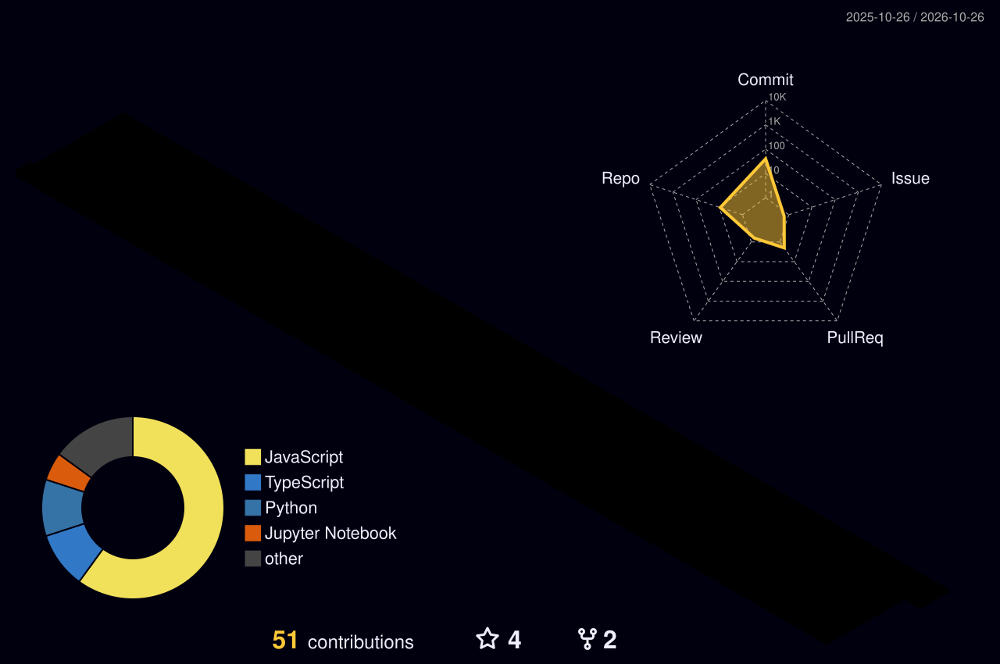

  

  

  I'm building <b>晨述 DawnTale</b> — one person's story, a daily rhythm, and an AI that learns from both. 
  Next I'm taking it toward <b>AI × BCI × EEG</b>, and building it in public with a community.

  
  
  
  
  

---

### 🌅 What I'm building

<table>
  <tr>
    <td width="33%" valign="top">
      <h4>晨述 · DawnTale</h4>
      A personal AI that fits one life — daily rhythm, reflections, plans — built widget by widget for desktop and phone. Your data stays yours.  
      <a href="https://dawntale.app"><b>dawntale.app →</b></a>
    </td>
    <td width="33%" valign="top">
      <h4>AI × BCI × EEG</h4>
      The next chapter: real-time EEG and brain–computer interfaces as a new input for personal AI — from brain signals to everyday tools.  
      <a href="https://jaxonzhao.com"><b>follow along →</b></a>
    </td>
    <td width="33%" valign="top">
      <h4>DawnLog · DawnCom</h4>
      Building in public: decision logs on what broke and how I fixed it, plus a community to talk AI and join events.  
      <a href="https://log.dawntale.app"><b>log</b></a> · <a href="https://community.dawntale.app"><b>community →</b></a>
    </td>
  </tr>
</table>

  

---

### ⚡ Live on GitHub

  

  

<!--LIVE-ACTIVITY:START-->
| | Repo | Latest commit | When |
|:-:|:--|:--|--:|
| ⚪ | [machine-driven-evaluation](https://github.com/zichenzha0/machine-driven-evaluation) | [Fix topic-set scoring, asymmetric sentence-level similari…](https://github.com/zichenzha0/machine-driven-evaluation/commit/16817b1b0f82daea4b6e686bb450d8b4d97e627c) | 33 days ago |
| ⚪ | [offerproof](https://github.com/zichenzha0/offerproof) | [Fix the blank dashboard by installing react-router in the…](https://github.com/zichenzha0/offerproof/commit/ce8b05ad2b272bee6675bee12ce1e5ef441c0001) | 36 days ago |
| ⚪ | [offerproof](https://github.com/zichenzha0/offerproof) | [Add HIRETRUSTHACKTHON source so the original dashboard li…](https://github.com/zichenzha0/offerproof/commit/00e91f4782d9fd630f8f0c6ed8337b30bb35ff68) | 36 days ago |
| ⚪ | [offerproof](https://github.com/zichenzha0/offerproof) | [commit](https://github.com/zichenzha0/offerproof/commit/2bad73cede35c2128920e548943f166998a4b5ba) | 37 days ago |
| ⚪ | [offerproof](https://github.com/zichenzha0/offerproof) | [Initial commit](https://github.com/zichenzha0/offerproof/commit/66861feea7f0978df059a82b288ffe546ff97527) | 37 days ago |
| ⚪ | [tech_universe](https://github.com/zichenzha0/tech_universe) | [commit](https://github.com/zichenzha0/tech_universe/commit/5bafb0b040166587ea389c98f52e52c398bc18f3) | 131 days ago |

🔄 auto-synced Oct 26, 3:56 PM ET

<!--LIVE-ACTIVITY:END-->

  <picture>
    <source media="(prefers-color-scheme: dark)" srcset="https://raw.githubusercontent.com/zichenzha0/zichenzha0/output/github-snake-dark.svg" />
    <source media="(prefers-color-scheme: light)" srcset="https://raw.githubusercontent.com/zichenzha0/zichenzha0/output/github-snake.svg" />
    
  </picture>

  

